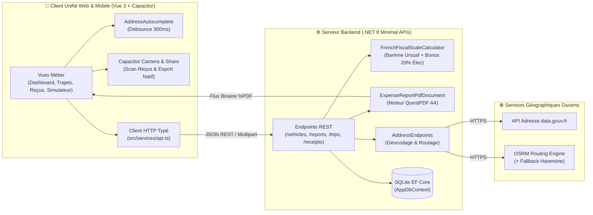

# 🚗 FraisRoute — Gestion des Indemnités Kilométriques & Notes de Frais (Web / Mobile)

[](./LICENSE)
[](https://dotnet.microsoft.com/)
[](https://vuejs.org/)
[](https://www.typescriptlang.org/)
[](https://capacitorjs.com/)
[](./sonar-project.properties)

**FraisRoute** est une plateforme complète et open-source de gestion des **frais de déplacement professionnels** et de calcul des **indemnités kilométriques (IK)** conforme aux barèmes officiels français (**Urssaf / DGFIP**). Elle repose sur une codebase unifiée **Web & Mobile (Vue 3 + Capacitor)** propulsée par une API **.NET 8 Minimal APIs**, une persistance **SQLite** embarquée et un moteur d'export **PDF officiel (QuestPDF)**.

---

## ✨ Fonctionnalités Clés

- **⚖️ Moteur Fiscal Officiel Urssaf / DGFIP (`FrenchFiscalScaleCalculator`)** :
  - Prise en charge intégrale des grilles officielles **Voitures** (3 CV et moins à 7 CV et plus), **Motos** (1 à > 5 CV) et **Cyclomoteurs / Scooters**.
  - Calcul progressif multi-tranches annuelles (`≤ 5 000 km`, `5 001 à 20 000 km`, `> 20 000 km`) avec **régularisation différentielle automatique** lors du franchissement de tranche en cours d'année.
  - Application automatique de la **majoration légale de +20 %** pour les véhicules **100 % électriques**.
  - Support des barèmes forfaitaires négociés en entreprise (ex: `0,45 €/km`) et des taux de prise en charge employeur partiels (ex: `80 %` ou `100 %`).
- **🗺️ Saisie Intelligente de Trajets & Calcul Routier** :
  - Autocomplétion d'adresses françaises en temps réel via l'API nationale ouverte **`api-adresse.data.gouv.fr`** (sans clé API requise).
  - Calcul automatique de la distance routière entre le point de départ et d'arrivée via **OSRM Driving Route** avec repli mathématique **Haversine × 1.25** hors-ligne.
  - Bascule instantanée **Aller simple / Aller-Retour (×2)** avec prévisualisation en direct de l'indemnité due.
- **📸 Justificatifs, Frais Réels & Calcul Automatique de TVA** :
  - Prise de photo directe des tickets (péages, parkings, repas, carburant, hébergement) via **`@capacitor/camera`** sur mobile ou téléversement sur navigateur.
  - Extraction et calcul automatique de la **TVA récupérable** (`20 %`, `10 %`, `5,5 %`, `0 %`) à partir du montant TTC.
- **📄 Export & Partage PDF Certifié (`QuestPDF`)** :
  - Génération serveur à la volée d'un document PDF officiel prêt pour la comptabilité : tableau détaillé des déplacements, récapitulatif des frais annexes, ventilation HT/TVA/TTC, net à payer et encarts de signature Salarié / Direction.
  - Partage natif sur iOS / Android via **`@capacitor/share`** ou téléchargement direct en un clic.

---

## 🏗️ Architecture Système



---

## 🚀 Installation & Démarrage Rapide

### Prérequis
- **.NET SDK** `>= 8.0`
- **Node.js** `>= 22.0.0` et **npm** `>= 10.0.0`

### 1. Cloner et installer
```bash
git clone https://github.com/IAlexy/frais-route.git
cd frais-route

# Restaurer les packages .NET et installer les dépendances Frontend
dotnet restore backend/FraisRoute.sln
npm --prefix frontend install
```

### 2. Configuration (Optionnelle)
La base de données SQLite (`fraisroute.db`) ainsi que deux véhicules de démonstration (*Peugeot 208 5 CV Thermique* et *Tesla Model 3 6 CV Électrique*) sont initialisés automatiquement au premier démarrage. Vous pouvez personnaliser la configuration en copiant `.env.example` :
```bash
cp .env.example .env
```

### 3. Lancer l'application
Ouvrez deux terminaux depuis la racine du projet :
```bash
# Terminal 1 : Serveur API .NET 8 (http://127.0.0.1:5000 & Swagger sur /swagger)
npm run dev:backend

# Terminal 2 : Interface Frontend Vite (http://localhost:5173)
npm run dev:frontend
```
Puis ouvrez `http://localhost:5173` dans votre navigateur.

---

## 📱 Build Mobile iOS & Android (Capacitor)

```bash
cd frontend
npm run build
npx cap add android
npx cap add ios
npx cap sync
```

---

## 🧪 Tests Automatisés & Analyse Statique Sonar

Le projet applique une politique stricte **0 Warning / 0 Error** validée par **`SonarAnalyzer.CSharp`**, **`vue-tsc`** et **`oxlint`**, accompagnée de **78 tests automatisés** (**64 tests Backend xUnit** + **14 tests Frontend Vitest**) :

```bash
# Lancer l'intégralité des tests (Backend xUnit + Frontend Vitest)
npm test

# Lancer uniquement les tests Backend (Barème Urssaf, QuestPDF, Intégration API SQLite)
npm run test:backend

# Lancer uniquement les tests Frontend (Client API + Composants & Vues UI)
npm run test:frontend

# Générer les rapports de couverture complets (OpenCover C# + LCOV TypeScript)
npm run test:coverage

# Vérifier l'analyse statique Sonar C# (-warnaserror) et le linter Frontend (Oxlint)
npm run lint

# Vérifier le typage TypeScript strict (vue-tsc)
npm run typecheck
```

---

## 📡 Référence des Endpoints API REST (`http://localhost:5000`)

### 🚘 Véhicules (`/api/vehicles`)

| Méthode | Route | Description |
| :--- | :--- | :--- |
| `GET` | `/api/vehicles` | Liste tous les véhicules triés par véhicule par défaut. |
| `GET` | `/api/vehicles/{id}` | Récupère le détail d'un véhicule par son identifiant. |
| `POST` | `/api/vehicles` | Crée un véhicule et bascule automatiquement le véhicule par défaut. |
| `PUT` | `/api/vehicles/{id}` | Met à jour les caractéristiques fiscales (CV, motorisation, taux) d'un véhicule. |
| `DELETE` | `/api/vehicles/{id}` | Supprime un véhicule et réassigne automatiquement un véhicule par défaut. |

### 📁 Notes de Frais & Export PDF (`/api/reports`)

| Méthode | Route | Description |
| :--- | :--- | :--- |
| `GET` | `/api/reports` | Liste les résumés de toutes les notes de frais avec totaux calculés. |
| `GET` | `/api/reports/{id}` | Détail complet d'une note incluant ses trajets et ses justificatifs. |
| `POST` | `/api/reports` | Crée une nouvelle note mensuelle (`409 Conflict` si la période existe déjà). |
| `PUT` | `/api/reports/{id}` | Met à jour les informations générales d'une note de frais. |
| `PATCH` | `/api/reports/{id}/status` | Modifie le statut de validation (`Draft`, `Submitted`, `Approved`, `Rejected`). |
| `DELETE` | `/api/reports/{id}` | Supprime une note de frais et ses éléments rattachés en cascade. |
| `GET` | `/api/reports/{id}/pdf` | Génère et télécharge le document PDF officiel via **QuestPDF**. |

### 🛣️ Trajets & Justificatifs (`/api/reports/{reportId}/...`)

| Méthode | Route | Description |
| :--- | :--- | :--- |
| `GET` | `/api/reports/{reportId}/trips` | Liste les déplacements enregistrés sur une note de frais. |
| `POST` | `/api/reports/{reportId}/trips` | Ajoute un trajet (simple ou A/R) avec calcul automatique du cumul annuel Urssaf. |
| `PUT` | `/api/reports/{reportId}/trips/{tripId}` | Modifie un trajet existant et recalcule son indemnité kilométrique. |
| `DELETE` | `/api/reports/{reportId}/trips/{tripId}` | Supprime un trajet et met à jour la note de frais. |
| `GET` | `/api/reports/{reportId}/receipts` | Liste les reçus et frais réels d'une note de frais. |
| `POST` | `/api/reports/{reportId}/receipts` | Ajoute un justificatif avec calcul automatique de la TVA à partir du TTC. |
| `POST` | `/api/reports/{reportId}/receipts/{receiptId}/upload` | Téléverse la photo justificative (`multipart/form-data`). |
| `DELETE` | `/api/reports/{reportId}/receipts/{receiptId}` | Supprime un justificatif de la note de frais. |

### 🧮 Calculateur IK & Géolocalisation (`/api/calculator`, `/api/addresses`)

| Méthode | Route | Description |
| :--- | :--- | :--- |
| `POST` | `/api/calculator/simulate` | Simule une indemnité kilométrique selon le barème Urssaf ou un taux fixe. |
| `GET` | `/api/calculator/ik` | Simulation rapide par paramètres de requête (`distanceKm`, `fiscalHorsepower`, `isElectric`). |
| `GET` | `/api/calculator/rates` | Retourne la grille officielle de référence des taux au kilomètre (`3 CV` à `7 CV+`). |
| `GET` | `/api/addresses/autocomplete?q=...` | Autocomplétion d'adresses françaises via `api-adresse.data.gouv.fr`. |
| `GET` | `/api/addresses/search?q=...` | Recherche d'adresses avec validation stricte des paramètres (`400 BadRequest` si `< 2` car.). |
| `GET` | `/api/addresses/route` | Calcule la distance routière (OSRM + repli Haversine × 1.25) entre 2 coordonnées GPS. |
| `GET` | `/api/addresses/distance` | Calcule la distance routière avec validation stricte des bornes géographiques. |

---

## 📁 Structure du Projet

```text
frais-route/
├── .github/workflows/
│   └── ci.yml                                    # Pipeline CI/CD GitHub Actions (.NET 8 + Vue 3 + Sonar)
├── backend/
│   ├── Directory.Build.props                     # Configuration globale SonarAnalyzer.CSharp & .NET 8
│   ├── FraisRoute.sln                            # Solution .NET 8
│   ├── FraisRoute.Api/                           # Serveur Backend ASP.NET Core Minimal APIs
│   │   ├── Data/AppDbContext.cs                  # Contexte EF Core SQLite & données initiales
│   │   ├── DTOs/                                 # Contrats de transfert de données immuables (records)
│   │   ├── Endpoints/                            # Routes REST (Vehicles, Reports, Trips, Receipts, Calculator, Addresses)
│   │   ├── Models/                               # Entités métier (Vehicle, ExpenseReport, Trip, ReceiptExpense)
│   │   ├── Services/
│   │   │   ├── FrenchFiscalScaleCalculator.cs    # Moteur de calcul officiel Urssaf / DGFIP
│   │   │   └── ExpenseReportPdfDocument.cs       # Générateur de rapport PDF A4 QuestPDF
│   │   └── Program.cs                            # Point d'entrée, injection de dépendances & middleware
│   └── FraisRoute.Tests/                         # Suite de tests automatisés xUnit
│       ├── FrenchFiscalScaleCalculatorTests.cs   # Tests unitaires exhaustifs du barème fiscal
│       ├── ExpenseReportPdfDocumentTests.cs      # Tests unitaires de génération PDF QuestPDF
│       └── ApiEndpointsIntegrationTests.cs       # Tests d'intégration HTTP de bout en bout (WebApplicationFactory)
├── frontend/
│   ├── src/
│   │   ├── components/                           # Composants réutilisables (BottomNav, AddressAutocomplete)
│   │   ├── router/index.ts                       # Configuration Vue Router
│   │   ├── services/api.ts                       # Client HTTP typé & modèles TypeScript
│   │   └── views/                                # Vues principales (Dashboard, ReportDetail, AddTrip, AddReceipt, Vehicles, Simulator)
│   ├── tests/
│   │   ├── unit/api.test.ts                      # Tests unitaires du service API & gestion d'erreurs HTTP
│   │   └── ui/                                   # Tests de composants et de vues Vue Test Utils / JSDOM
│   ├── capacitor.config.ts                       # Configuration native iOS / Android
│   ├── vite.config.ts                            # Configuration Vite 8 & Tailwind CSS v4
│   └── vitest.config.ts                          # Configuration Vitest & couverture V8 LCOV
├── CONTRIBUTING.md                               # Guide de contribution et standards qualité
├── LICENSE                                       # Licence MIT
├── package.json                                  # Scripts racine unifiés (test, build, lint, typecheck)
└── sonar-project.properties                      # Configuration SonarQube / SonarCloud
```

---

## 📄 Licence

Distribué sous licence **MIT**. Voir le fichier [LICENSE](./LICENSE) pour plus d'informations.
